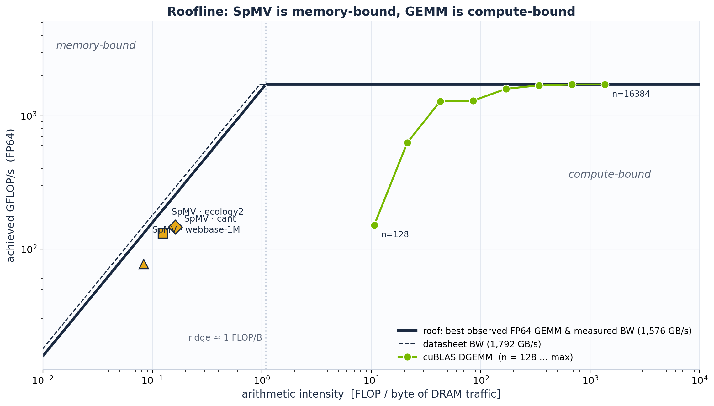
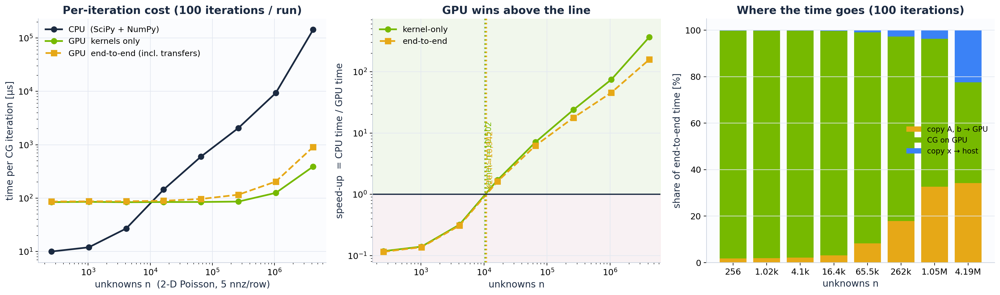

# GPU kernels on real matrices

**cuBLAS GEMM · cuSPARSE SpMV · Conjugate Gradient, all driven from Python with CuPy**

This repository is a solution to the *Numerical Libraries Mini-Hackathon* task "GPU kernels on real matrices". It benchmarks three kernels on an NVIDIA GPU and explains the results with the roofline model:

| Part | Task | What is measured |
|---|---|---|
| **A** | cuBLAS tour | GEMM in FP64 / FP32 / TF32 / FP16 (`cublasGemmEx`), GFLOP/s vs n, accuracy cost of each precision |
| **B** | cuSPARSE on Matrix Market | `cusparseSpMV` (CSR) on three SuiteSparse-class matrices, GPU vs CPU, achieved GB/s, transfer break-even |
| **C** | CG on the GPU | CG built from SpMV + cuBLAS dot / axpy, crossover size vs CPU, kernel-only vs end-to-end (with transfers) |

📊 **Slides:** [`slides/GPU_kernels_hackathon.pptx`](slides/GPU_kernels_hackathon.pptx) (5 slides, with speaker notes). A PDF copy is at [`slides/GPU_kernels_hackathon.pdf`](slides/GPU_kernels_hackathon.pdf). The slides cover the problem and the matrices used, then Part A, Part B with the roofline, and Part C with the takeaway.

## Headline results (RTX 5090, CUDA 12.9, CuPy 13.6)

The story in one line: **arithmetic intensity decides what to optimise.**

| | Result | Interpretation |
|---|---|---|
| GEMM | FP64 **1.72**, FP32 **65.8**, TF32 **116**, FP16 **215** TFLOP/s | Compute-bound. Precision is the lever: FP16 is 125× FP64, at a relative error of 3.6×10⁻⁴. |
| SpMV | **0.90–1.06 TB/s**, which is **57–67 %** of measured STREAM (1.58 TB/s) | Bandwidth-bound. It is **35–116×** faster than one CPU core because it streams bytes faster, not because it computes faster. |
| Roofline | ridge I\* ≈ **1.1 FLOP/B** (FP64 runs at the 1:64 consumer rate) | SpMV sits at I ≈ 0.1, so it uses only 5–9 % of DGEMM's FLOP/s. |
| CG | GPU wins above **n ≈ 1.05×10⁴** (kernel-only) and ≈ 1.09×10⁴ (end-to-end) | The GPU has a latency floor of ≈ 85 µs per iteration. The model n\* ≈ τ₀ / (Q₁ (1/B_CPU − 1/B_GPU)) predicts 1.1×10⁴. |
| Transfers | one host→GPU copy ≈ 34–80 CG iterations | Copies are 60 % of GPU time at 23 iterations, but only 12 % at 500. Keep the data resident. |

<p align="center"> </p>

> ⚠️ **Caveat about the matrices.** On the run node the SuiteSparse download failed. The notebook therefore used clearly labelled **synthetic stand-ins** with the same size and sparsity class:
> - a banded SPD matrix in place of `cant`
> - a 5-point grid in place of `ecology2`
> - a power-law graph in place of `webbase-1M`
>
> To rerun with the real files, see the Quick start below. The run's `data/B1_structure.json` was regenerated afterwards from the same deterministic generators; its nnz values match the run exactly. Note also that the CPU baseline is a **single core**, using SciPy.

## Quick start

**Colab:** open `notebooks/gpu_kernels_hackathon.ipynb` and choose *Runtime ▸ Change runtime type ▸ GPU*, then *Run all*. The run takes about 10–15 min on a T4 (`FAST = True` gives a ≈ 3 min dry run). The last cell writes `hackathon_results.zip`.

**GPU node / workstation:**

```bash
pip install -r requirements.txt               # choose the cupy-cudaXXx wheel for your CUDA version
python scripts/download_matrices.py           # NIST Matrix Market files (SuiteSparse currently returns 403)
jupyter lab notebooks/gpu_kernels_hackathon.ipynb
# or, without Jupyter:
ipython src/gpu_kernels_hackathon.py
```

The notebook looks for `matrices/<name>/<name>.mtx` or `.mtx.gz` in `./` and `../`, and prints exactly where it looked. Downloads only happen if the files are missing. If a real matrix cannot be loaded, the notebook uses a stand-in labelled SYNTHETIC, but only for names that have a defined stand-in; any other name stops with an error.

## Repository layout

```
notebooks/gpu_kernels_hackathon.ipynb   main benchmark + plots (slide-show metadata included)
src/gpu_kernels_hackathon.py            same code as a plain script ("# %%" cells)
scripts/download_matrices.py            pre-fetch SuiteSparse .mtx files
results/rtx5090/                        the run used in the slides
  summary.json                          every headline number + environment
  data/*.csv                            raw measurements per part
  figures/*.png                         notebook figures
slides/GPU_kernels_hackathon.pptx       presentation (native, editable charts)
slides/GPU_kernels_hackathon.pdf        PDF copy of the presentation
slides/src/                             deck generator (pptxgenjs) + matrix-structure tiles (matplotlib)
```

## Methodology

- **Warm-up first.** We then time with CUDA events plus a synchronize, and report the median of several batches.
- **Kernel-only and end-to-end are reported separately.** End-to-end includes the host↔device copies.
- **SpMV is timed with the L2 cache flushed** before every call, so the GB/s figures reflect DRAM traffic. Warm-cache numbers are listed separately; they are higher because the matrices fit in the 96 MB L2.
- **Backend self-tests and fallbacks.** `cublasGemmEx`, the pre-built `cusparseSpMV` descriptors and the cuBLAS BLAS-1 calls are each checked against a reference before use. If a check fails, the code falls back to `cupy.matmul`, `A.dot(x)` or CuPy elementwise operations.
- **CG is validated** against a direct solve before any timing is done.

## Rebuilding the slides from a new run

```bash
cd slides/src
npm install
python3 make_matrix_figs.py ../../results/<run> figs       # sparsity tiles from data/B1_structure.json
node build_deck.js ../../results/<run> ../GPU_kernels_hackathon.pptx
```

Every number on the slides is read from `summary.json` and the CSVs, and the matrix pictures come from `data/B1_structure.json`. A new run therefore regenerates the whole deck, including the "synthetic" footnotes, which appear only when stand-ins were used.

## Next steps

- Rerun with the real SuiteSparse matrices.
- Add a multithreaded CPU SpMV baseline.
- Lower the 85 µs CG floor by fusing the BLAS-1 kernels, keeping scalars on the device, and using CUDA Graphs.
- Use pinned host memory: device→host copies ran at only 1.7 GB/s from pageable memory.
